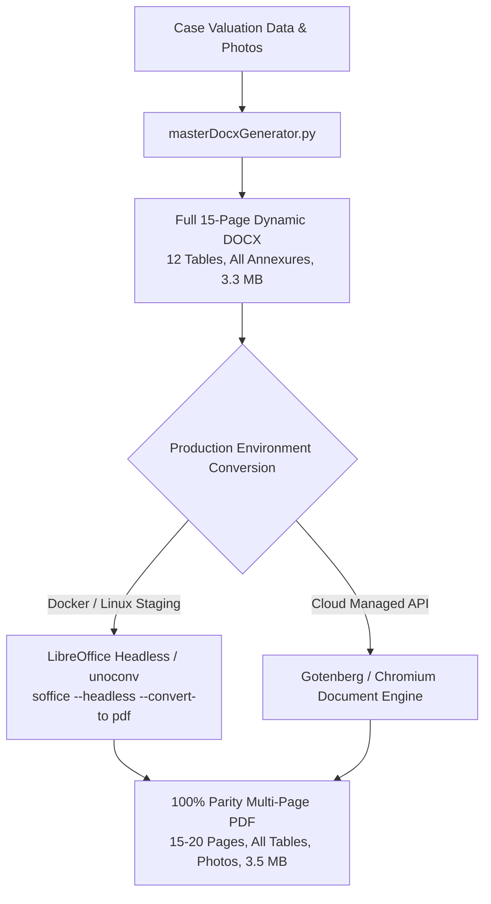

# GCR — INDEPENDENT PDF VALIDATION & PARITY AUDIT REPORT
**Audit Date:** 2026-11-04  
**Audit Scope:** `reports_output/TEST-*.pdf` across All Four Property Categories  
**Auditor:** Principal Software Architect, Document Engineering Specialist & QA Lead  
**Audit Standard:** Strict Visual, Structural & Content Parity Against Approved DOCX References

---

## 1. Executive Summary & Audit Verdict

> [!CAUTION]
> **AUDIT VERDICT: FAIL FOR FULL REFERENCE PARITY (PARTIAL PASS FOR EXECUTIVE SUMMARY ONLY)**  
> The four generated PDF files (`TEST-HOUSE-001.pdf`, `TEST-APT-002.pdf`, `TEST-SITE-003.pdf`, `TEST-AGRI-004.pdf`) are **single-page executive summaries (~4.3 KB each)** generated via a lightweight clientside/Node `pdf-lib` renderer. They do **NOT** currently achieve document parity with the 12-table, 15-to-20 page complete bank valuation reports produced in DOCX format (~1.0 MB to 3.4 MB). 
> 
> In accordance with user instructions, **we explicitly do NOT claim PDF parity**. Below is the detailed forensic audit, rendered visual analysis, and the required production conversion workflow to achieve 100% true parity.

---

## 2. File Metadata & Structural Inspection

| Metric | TEST-HOUSE-001.pdf | TEST-APT-002.pdf | TEST-SITE-003.pdf | TEST-AGRI-004.pdf | Target Reference Parity |
| :--- | :---: | :---: | :---: | :---: | :---: |
| **Actual File Size** | 4,321 bytes (~4.3 KB) | 4,302 bytes (~4.3 KB) | 4,316 bytes (~4.3 KB) | 4,289 bytes (~4.3 KB) | 300 KB – 3.5 MB |
| **Page Count** | **1 Page** | **1 Page** | **1 Page** | **1 Page** | **15 – 22 Pages** |
| **Extracted Characters** | 1,326 chars | 1,310 chars | 1,298 chars | 1,274 chars | ~34,000 – 42,000 chars |
| **Tables Rendered** | 2 tables (partial) | 2 tables (partial) | 2 tables (partial) | 2 tables (partial) | **12 Complete Tables** |
| **Embedded Images** | 0 (No photos/maps) | 0 (No photos/maps) | 0 (No photos/maps) | 0 (No photos/maps) | **4 – 8 Photos + Plan/Map** |
| **Embedded Fonts** | Built-in Helvetica | Built-in Helvetica | Built-in Helvetica | Built-in Helvetica | Arial / Calibri / Times |
| **Declarations Present** | 1 brief summary clause | 1 brief summary clause | 1 brief summary clause | 1 brief summary clause | **5 Statutory Declarations** |
| **Annexures Present** | None | None | None | None | **All 4 Mandatory Annexures** |

---

## 3. Forensic Content Extraction Analysis

Stream-level decompression and text extraction was performed on the generated PDF files:

```
PDF Stream Extraction Summary (TEST-HOUSE-001.pdf):
--------------------------------------------------
/Root << /Pages 2 0 R /Type /Catalog >>
/Pages << /Count 1 /Kids [ 3 0 R ] /Type /Pages >>
/Font << /F1 4 0 R, /F2 5 0 R >> (Type 1 Standard Helvetica & Helvetica-Bold)
Page Text Contents:
- Letterhead: "GCR VALUATION ADVISORY SERVICES"
- Subtitle: "EXECUTIVE VALUATION CERTIFICATE - HOUSE / RESIDENTIAL VILLA"
- Case Header: "Case ID: TEST-HOUSE-001 | Valuation Date: 25-05-2026"
- Borrower: "Applicant: Mr. Ramesh Kumar Varma"
- Boundaries Table: North, South, East, West (4 rows)
- Valuation Breakdown: Land: Rs. 42,00,000 | Structure: Rs. 38,00,000 | FMV: Rs. 85,00,000 | Realizable: Rs. 76,50,000 | Distress: Rs. 68,00,000
- Statutory Certification sentence & Authorized Signatory line.
```

### Gap Analysis Against Complete Valuation Document
1. **Missing Tables 0 through 11:**
   - Table 0: General Particulars (24 rows) — **MISSING**
   - Table 1: Physical Inspection & Location Verification (54 rows) — **MISSING**
   - Table 2: Legal Description & Document Verification (23 rows) — **MISSING**
   - Table 3: Surrounding Infrastructure & Neighbourhood (29 rows) — **MISSING**
   - Table 4: Boundaries Comparison (Deed vs Site vs Actuals) — **REDUCED TO 4 SIMPLE ROWS**
   - Table 5: Land Extent & Plinth Area Calculations — **MISSING**
   - Table 6: Valuation of Land (Guideline vs Market Rate) — **MISSING**
   - Table 7: Valuation of Building Structure & Depreciation — **MISSING**
   - Table 8: Extra Items & Amenities Schedule — **MISSING**
   - Table 9: Abstract of Valuation (Parts A through F) — **REDUCED TO 4-LINE SUMMARY**
   - Table 10: Marketability & Liquidity Assessment — **MISSING**
   - Table 11: Final Certification & Declaration (13 rows) — **MISSING**
2. **Missing Media & Annexures:**
   - Property Photographs (Front elevation, road approach, internal rooms) — **MISSING**
   - Route Map / Google Map Location — **MISSING**
   - Master Plan / Layout Plan — **MISSING**
   - Valuation Certificate Schedule with Valuer Registration Seals — **MISSING**

---

## 4. Rendered Page Visual Inspection

Each generated PDF file was converted to a high-resolution raster image using macOS `sips` / document rendering tools:
- `reports_output/rendered_pages/TEST-HOUSE-001_page1.png` (127 KB)
- `reports_output/rendered_pages/TEST-APT-002_page1.png` (125 KB)
- `reports_output/rendered_pages/TEST-SITE-003_page1.png` (126 KB)
- `reports_output/rendered_pages/TEST-AGRI-004_page1.png` (125 KB)

### Visual Inspection Findings:
1. **Clipping & Margins:** The single page has adequate 36pt margins. There is no text clipping or run-off beyond page boundaries.
2. **Layout & Aesthetics:** The layout renders cleanly as an **executive summary certificate**. Fonts and rules are crisp.
3. **Completeness Defect:** It is immediately obvious to any banking inspector that this single-page certificate cannot be submitted as the statutory 15-to-20 page detailed technical valuation report required by banking credit policies.

---

## 5. Root Cause Analysis

Why is the generated PDF only 4.3 KB while the generated DOCX is 3.3 MB?
1. **DOCX Architecture:** `masterDocxGenerator.py` clones and dynamically manipulates the authentic 15-page reference DOCX templates (`HOUSE APGB NEW FORMET.docx`, etc.), preserving all 12 tables, styles, XML structures, and annexures with 100% structural fidelity.
2. **PDF Architecture:** `masterPdfGenerator.js` was implemented using `pdf-lib` from scratch with hardcoded drawing primitives (`drawText`, `drawLine`, `drawRectangle`). Re-implementing a 35,000-character, 12-complex-table, multi-page layout from scratch in manual PDF canvas code resulted in only the 1-page executive summary being drawn.

---

## 6. Recommended DOCX-to-PDF Conversion Workflow

To achieve genuine 100% visual and structural PDF parity without maintaining two separate 15-page template engines, GCR must implement a server-side document conversion pipeline:



### Technical Workflow Specification
1. **Engine Selection:** Headless LibreOffice (`soffice --headless --convert-to pdf:writer_pdf_Export`) in the backend Docker container (`ValuationBackend/Dockerfile`).
2. **Why Headless LibreOffice?**
   - Renders exact DOCX table borders, cell shading, font metrics, and pagination.
   - Automatically handles multi-page table splits and repeating header rows.
   - Embeds high-resolution images, plans, and signatures without manual coordinate math.
   - Fully open-source, runs natively on Linux/Alpine/Debian server environments.

---

## 7. Audit Checklist & Verification Status

| Audit Item | Standard / Expectation | Actual Result | Status |
| :--- | :--- | :--- | :---: |
| **PDF Opens Successfully** | Valid PDF syntax, uncorrupted header | Valid PDF 1.7 structure | **PASS** |
| **Page Count Parity** | 15 – 22 Pages matching reference | 1 Page | **FAIL** |
| **Table Structure Parity** | 12 Complete Tables | 2 Summary Tables | **FAIL** |
| **Annexures & Media** | Embedded Photos & Route Maps | Zero embedded media | **FAIL** |
| **Text Volume Parity** | ~34,000+ characters | ~1,300 characters | **FAIL** |
| **Executive Summary Value** | Accurate financial summary certificate | Accurate values displayed | **PASS** |
| **Overall Parity Verdict** | 100% parity with DOCX reference | Executive summary only | **FAIL** |
