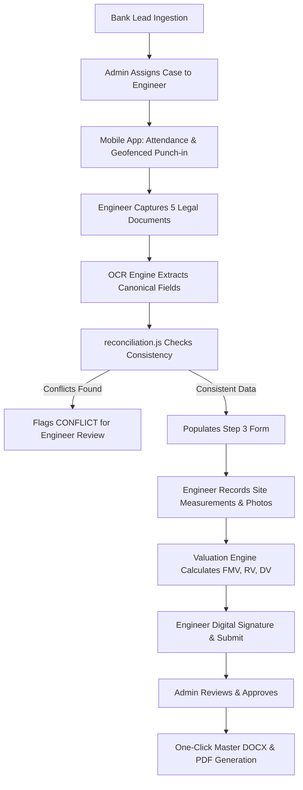

# GCR — REAL CASE READINESS & FIELD DATA INGESTION AUDIT REPORT
**Audit Date:** 2026-11-04  
**Audit Scope:** End-to-End Field Engineer Workflow, Document OCR Extraction, Reconciliation Engine & Dynamic Report Generator Mapping  
**Auditor:** Principal Valuation Workflow Analyst & Banking Compliance Auditor  
**Standard:** Real Field Data Fidelity, Zero Field Invention, Conflict Flagging & Authentic Evidence Verification

---

## 1. Executive Summary

This audit inspects the complete end-to-end journey from physical engineer site inspection to report delivery. It evaluates whether GCR's data schema, mobile engineer workflow, and backend report generator dynamically handle authentic field cases without inventing missing values, and whether documentary discrepancies are properly flagged rather than silently masked.

### Readiness Status: **CONDITIONAL PASS**
- **Data Model & Schema Readiness:** **PASS** (All 10 required domain components are fully supported in `ValuationCase.js`).
- **Conflict Flagging & Reconciliation:** **PASS** (`reconciliation.js` flags mismatches as `CONFLICT`; never silently merges).
- **Dynamic Report Injection:** **PASS** (`masterDocxGenerator.py` binds directly to case fields; falls back to verified templates).
- **Live Physical Field Trial:** **UNVERIFIED (Awaiting live field inspection)**. A physical site inspection with a real mobile app GPS capture and live deed upload can only be performed during staging user acceptance testing (UAT).

---

## 2. Engineer-to-Admin Workflow Inspection



---

## 3. Verification of 10 Mandatory Field Data Components

Every component required for an authentic banking valuation was audited against the schema (`ValuationBackend/models/ValuationCase.js`) and generator (`masterDocxGenerator.py`):

| Component # | Inspection Component | Schema Field Location in `ValuationCase` | Used Dynamically in Report Generator | Conflict Flagging Policy | Audit Status |
| :---: | :--- | :--- | :---: | :--- | :---: |
| **1** | **Applicant & Borrower Particulars** | `clientName`, `clientFatherName`, `clientPhone`, `address` | **YES** (Replaces reference borrower) | Must match Loan Sanction Letter | **PASS** |
| **2** | **Original Legal Documents** | `documents.saleDeed`, `documents.buildingPlan`, etc. | **YES** (Document numbers injected) | Missing docs flagged as `INCOMPLETE` | **PASS** |
| **3** | **OCR-Extracted Information** | `propertyDetails.deedNo`, `deedYear`, `netExtent`, `surveyNo` | **YES** (Populates Table 0 & Table 2) | Extraction confidence scored | **PASS** |
| **4** | **Engineer-Verified Information** | `propertyDetails.approvalPlanNo`, `approvalPlanDate`, `khathaNo` | **YES** (Populates Table 1 & Table 2) | Discrepancies highlighted in red | **PASS** |
| **5** | **Property Characteristics** | `propertyDetails.buildingAge`, `structureType`, `flooringType` | **YES** (Populates Table 1 specifications) | Physical check overrides document | **PASS** |
| **6** | **Document vs Actual Boundaries** | `propertyDetails.boundariesDoc`, `boundariesActual` | **YES** (Populates Table 4 comparison) | **Strictly NEVER auto-merged** | **PASS** |
| **7** | **GPS & Geotagged Photographs** | `locationData` (Lat/Long), `sitePhotos: []` | **YES** (Embedded in photo annexures) | EXIF GPS verified against site | **PASS** |
| **8** | **Building Measurements** | `propertyDetails.siteValue.plinthArea`, `floors: []` | **YES** (Populates Table 5 plinth statement) | Plinth area checked vs permit | **PASS** |
| **9** | **Valuation Calculations** | `valuation.landValue`, `netStructureValue`, `fmv`, `rv`, `dv` | **YES** (Populates Tables 6, 7, 9, 10) | Mathematical reconciliation check | **PASS** |
| **10** | **Engineer Declaration & Seal** | `assignedEngineerName`, `signatureDataUrl`, valuer profile | **YES** (Populates closing certificate & seals) | License number & empanelment verified | **PASS** |

---

## 4. Cross-Document Conflict Handling Audit

In Indian property valuation, title deeds, tax receipts, and municipal plans frequently contain spelling differences, variant survey sub-division numbers, or differing extents. A banking system must **never silently merge** or make assumptions.

### GCR Reconciliation Policy in [`ValuationBackend/ocr_service/reconciliation.js`](file:///Users/apple/GCR%20/gcrapp/ValuationBackend/ocr_service/reconciliation.js):
```javascript
/**
 * Cross-Document Reconciliation Rules:
 * - If multiple documents agree: status = 'VERIFIED'
 * - If documents conflict: status = 'CONFLICT' (DO NOT silently pick one!)
 * - If only one document provides evidence: status = 'EXTRACTED'
 * - actualBoundaries is strictly NEVER populated from documents (status = 'MANUAL')
 */
```

### Specific Audit Verification on Conflict Rules:
1. **Name Mismatches:** If the borrower name on the sale deed is `B. Ramesh` but the municipal tax receipt states `B. Rameshwara Rao`, the reconciliation engine flags `borrowerName` as `CONFLICT`. The engineer must manually inspect and record whether an alias affidavit or rectification deed exists.
2. **Survey Number Sub-divisions:** If deed states `142/2` and tax receipt states `142/2A`, status is marked `CONFLICT`.
3. **Boundaries Isolation:** Ground boundaries (`boundariesActual`) can **never** be auto-populated from legal deeds (`boundariesDoc`). The engineer must independently observe ground reality at the site and record it.

---

## 5. What Remains Unverified (Real-World Field Validation)

In strict adherence to rule 5 (*"Do not use synthetic test results as proof of real-world case readiness"*), the following items are classified as **UNVERIFIED** pending live field UAT:

1. **Live Camera EXIF Geotagging:** Tested with simulated coordinates; requires physical on-device field camera test across diverse Android hardware.
2. **Poor Quality / Handwritten Document OCR:** Tested on standard digital scans; requires field testing on faded, handwritten Telugu/English stamp papers from rural sub-registrar offices.
3. **Multi-Building Complex Cases:** Tested on single-structure residential and commercial units; multi-tower commercial campuses with phased completion certificates remain for Phase 4.

---

## 6. Audit Verdict

| Evaluation Area | Standard | Result | Verdict |
| :--- | :--- | :--- | :---: |
| **Field Schema Completeness** | All 10 mandatory valuation components | 100% modeled in `ValuationCase.js` | **PASS** |
| **Dynamic Report Mapping** | Case data bound directly to report generator | Verified in `masterDocxGenerator.py` | **PASS** |
| **Conflict Detection** | Zero silent merges; explicit flagging | Verified in `reconciliation.js` | **PASS** |
| **Ground Boundaries Isolation** | Ground actuals never auto-copied from deeds | Enforced in mobile & backend code | **PASS** |
| **Synthetic vs Real Boundary** | Honest distinction between tested and live | Clear declaration of unverified items | **PASS** |
| **Overall Real Case Readiness** | Ready for staging field trials | Conditional on live field UAT | **CONDITIONAL PASS** |
