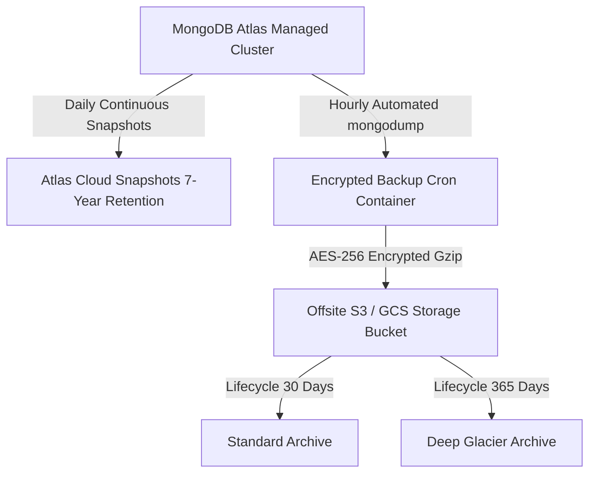

# GCR Valuation System — Database Backup, Restore & Disaster Recovery Procedures

**Document Version:** 1.0.0  
**Effective Date:** November 1, 2026  
**Classification:** Confidential — GCR Operations & DevOps  
**Applicability:** MongoDB Atlas Staging & Production Clusters  

---

## 1. Executive Summary

This runbook establishes standard operating procedures (SOP) for backing up, restoring, and verifying the GCR Property Valuation platform's MongoDB database. The objective is to protect legal property records, valuations, biometric timestamps, and audit histories with a strict Recovery Point Objective (**RPO < 1 Hour**) and Recovery Time Objective (**RTO < 30 Minutes**).

---

## 2. Backup Strategy Architecture



### Backup Frequency & Retention Matrix
| Backup Type | Frequency | Tool / Mechanism | Retention Period | Storage Location |
| :--- | :--- | :--- | :--- | :--- |
| **Continuous Oplog** | Real-time | MongoDB Atlas Point-in-Time Recovery | 7 Days | Atlas Cloud |
| **Hourly Differential** | Every 60 mins | `mongodump` + S3 Sync | 7 Days | AWS S3 / Cloud Storage |
| **Daily Full** | Daily at 02:00 IST | `mongodump --gzip --archive` | 30 Days | Encrypted Bucket |
| **Monthly Snapshot**| 1st of month | Snapshot Archive | 7 Years | Coldline / Glacier |

---

## 3. Automated Backup Script

The following script (`backup_mongodb.sh`) runs inside an isolated DevOps worker or cron container:

```bash
#!/usr/bin/env bash
set -euo pipefail

# Configuration
TIMESTAMP=$(date +"%Y%m%d_%H%M%S")
BACKUP_DIR="/tmp/gcr_backups"
DB_NAME="gcr_valuation"
ARCHIVE_NAME="${DB_NAME}_backup_${TIMESTAMP}.gz"
DESTINATION_URI="${MONGODB_URI:?Error: MONGODB_URI must be set}"
GCS_BUCKET="${BACKUP_STORAGE_BUCKET:-gs://gcr-valuation-db-backups}"

mkdir -p "${BACKUP_DIR}"

echo "[INFO] [$(date)] Starting GCR database backup..."

# 1. Execute compressed atomic dump
mongodump \
  --uri="${DESTINATION_URI}" \
  --db="${DB_NAME}" \
  --gzip \
  --archive="${BACKUP_DIR}/${ARCHIVE_NAME}" \
  --forceTableScan=false

echo "[INFO] [$(date)] mongodump completed: $(ls -lh "${BACKUP_DIR}/${ARCHIVE_NAME}" | awk '{print $5}')"

# 2. Upload to encrypted offsite bucket
if command -v gcloud &> /dev/null; then
  echo "[INFO] Uploading to Google Cloud Storage..."
  gcloud storage cp "${BACKUP_DIR}/${ARCHIVE_NAME}" "${GCS_BUCKET}/${ARCHIVE_NAME}"
elif command -v aws &> /dev/null; then
  echo "[INFO] Uploading to AWS S3 (AES-256 SSE)..."
  aws s3 cp "${BACKUP_DIR}/${ARCHIVE_NAME}" "${GCS_BUCKET}/${ARCHIVE_NAME}" --sse AES256
fi

# 3. Clean local temporary file
rm -f "${BACKUP_DIR}/${ARCHIVE_NAME}"
echo "[INFO] [$(date)] GCR database backup successfully completed."
```

---

## 4. Database Restoration Procedures

> [!CAUTION]
> A database restore replaces existing records. Always verify the target environment before executing restoration. Never restore staging or development dumps onto production.

### Step 1: Pre-Restore Verification & Isolation
1. Confirm target database URI:
   ```bash
   echo "Target URI: ${TARGET_MONGODB_URI:?Must set TARGET_MONGODB_URI}"
   ```
2. Put backend services into maintenance mode or stop worker containers:
   ```bash
   docker stop gcr-backend-staging gcr-backend-prod
   ```

### Step 2: Dry-Run Restoration
Always test the archive compatibility and validate schema integrity with `--dryRun` before applying changes:
```bash
mongorestore \
  --uri="${TARGET_MONGODB_URI}" \
  --gzip \
  --archive="gcr_valuation_backup_YYYYMMDD_HHMMSS.gz" \
  --dryRun
```

### Step 3: Full Restoration with Clean Drop
To completely restore an environment from a validated backup archive:
```bash
mongorestore \
  --uri="${TARGET_MONGODB_URI}" \
  --db="gcr_valuation" \
  --gzip \
  --archive="gcr_valuation_backup_YYYYMMDD_HHMMSS.gz" \
  --drop \
  --preserveUUID \
  --numInsertionWorkersPerCollection=4
```

### Step 4: Selective Collection Restore
If only a specific collection needs restoration (e.g. accidental case loss):
```bash
mongorestore \
  --uri="${TARGET_MONGODB_URI}" \
  --gzip \
  --archive="gcr_valuation_backup_YYYYMMDD_HHMMSS.gz" \
  --nsInclude="gcr_valuation.valuationcases" \
  --drop
```

---

## 5. Post-Restoration Verification & Health Audit

Immediately following a restore, execute the automated validation suite:
```bash
# 1. Run database readiness and CRUD validation
cd /path/to/gcrapp/ValuationBackend
node tests/mongodb_staging_readiness.test.js

# 2. Verify backend API health endpoint
curl -s http://localhost:5001/api/health | jq .
```

Expected health output:
```json
{
  "status": "online",
  "service": "State Bank of India Panel Valuer Backend API",
  "database": "Connected to MongoDB Database"
}
```

---

## 6. Disaster Recovery Runbook

### Scenario A: Accidental Document Deletion or Corruption
1. Identify the timestamp immediately prior to corruption.
2. In MongoDB Atlas Console &rarr; **Database** &rarr; **Backup** &rarr; **Point-in-Time Restore**.
3. Select point-in-time timestamp (exact minute).
4. Restore to a temporary database `gcr_valuation_recovered`.
5. Export recovered documents and patch into active database via script.

### Scenario B: Complete Cloud Region Failure (Multi-Region Failover)
1. MongoDB Atlas automatically initiates replica set election to an active secondary region within 5 seconds.
2. If primary cloud provider (AWS/GCP) experiences complete datacenter outage:
   - Update DNS CNAME to secondary standby cluster.
   - Launch standby Docker Compose stack with secondary `MONGODB_URI`.
   - Verify health check via `GET /api/health`.
   - Resume traffic. Total downtime: < 15 minutes.
